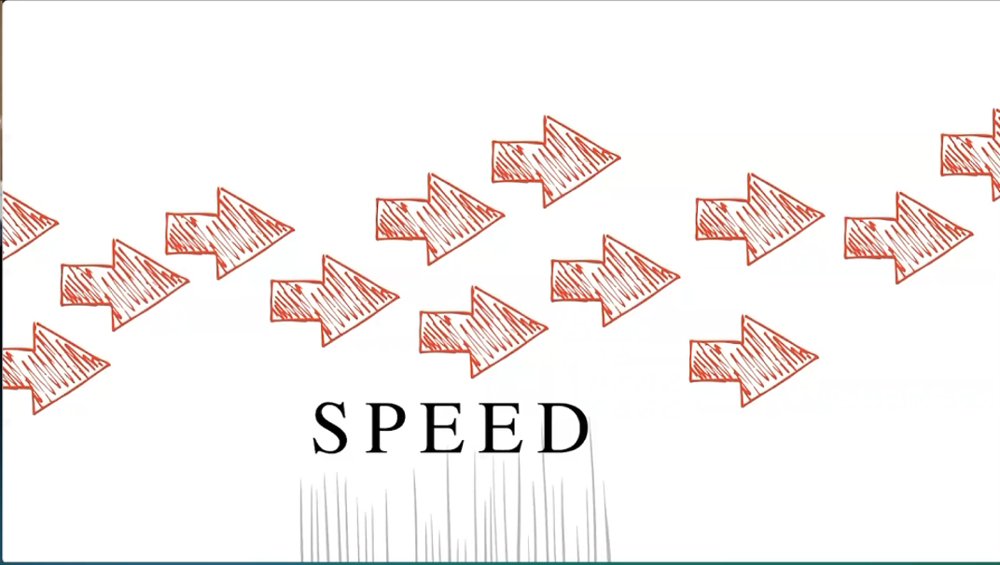
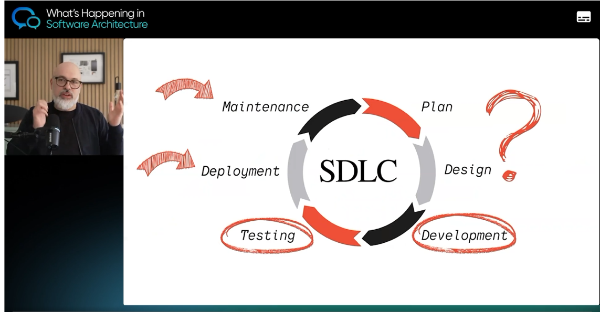
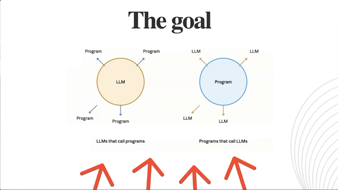
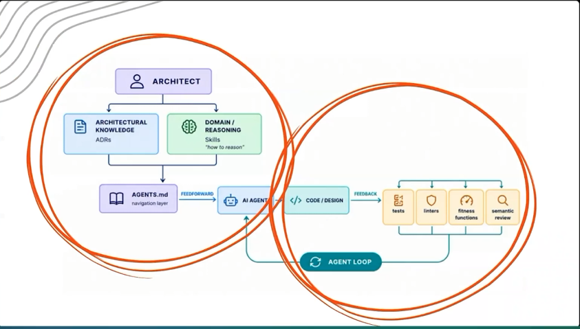
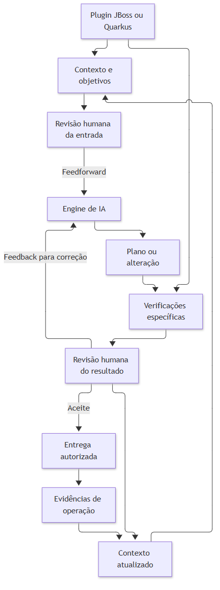

# Engineering Harness — estratégia e arquitetura

**Documento 1 de 3 · Revisão de 17/10/2026 · Proposta consolidada para decisão e implementação incremental**

**Leitura complementar:** [System design](02-system-design.md) · [Plano tático, fontes e auditoria](03-plano-tatico-e-implementacao.md)

## 1. Mensagem central

> Engineering Harness é uma plataforma local, extensível e independente de IDE e agente de IA, que compõe capacidades versionadas por perfil para executar tarefas de engenharia de software. Essas tarefas podem ser determinísticas, assistidas por IA ou híbridas, sendo conduzidas por contratos de contexto, autorização, execução e evidências. O feedforward orienta a atuação e o feedback permite validação, correção e aprendizado contínuo, preservando a autoridade humana.

Esta é a definição canônica do produto. Os outros documentos detalham sua realização; não introduzem definições concorrentes.

Na prática, o desenvolvedor configura as ferramentas que já possui, escolhe um projeto e um perfil e executa uma tarefa pela interface de sua preferência. O harness resolve as capacidades necessárias, prepara o contexto, aplica os controles cabíveis, acompanha a execução e apresenta resultados verificáveis. A participação de um agente é uma escolha do fluxo, não um pré-requisito para usar o produto.

**O diferencial não é reunir comandos em um menu. É ligar objetivo, contexto, decisão, execução e verificação sem obrigar o desenvolvedor a reconstruir essa ligação a cada trabalho.**

## 2. Por que evoluir a base existente

### 2.1. Origem da ideia

O `jboss-mta-harness` nasceu de um problema concreto: organizar diagnóstico, planejamento, corretivas e validação de uma migração JBoss EAP para 7.4 com apoio de IA e revisão humana. Ao resolver esse problema, ficou evidente que os mesmos procedimentos aparecem em desenvolvimento, qualidade e modernização: entender o problema, localizar evidências, delimitar uma alteração, verificar seus efeitos e decidir como continuar.

A reflexão de Luca Mezzalira em *What's Happening in Software Architecture* (O'Reilly, 22/09/2026) conecta essa experiência à adoção de IA no desenvolvimento: decidir o que acelerar, o que preservar e como verificar os resultados. [O28](03-plano-tatico-e-implementacao.md#fonte-o28)



*Figura 1. Speed — captura da apresentação de Luca Mezzalira, O'Reilly.*

A pressão por entregar 10, 20 ou 40 vezes mais coloca a velocidade no centro da discussão; arquitetura, resiliência e observabilidade continuam essenciais para sustentá-la. Para este produto, acelerar significa **reduzir o tempo até uma mudança útil, verificada e sustentável**. A quantidade de código produzida é avaliada junto com retrabalho, defeitos, esforço de revisão e impacto operacional.



*Figura 2. SDLC — planejamento e design em discussão, além de desenvolvimento e testes.*

Planejamento e design continuam parte do trabalho. A IA pode apoiar análise de alternativas e desenho da solução; cabe às pessoas confirmar o problema, compreender o domínio, definir prioridades e assumir as decisões. O harness torna esse contexto acessível e registra o que foi decidido.



*Figura 3. The goal — contraste entre LLMs que acionam programas e programas que acionam LLMs.*

Esse contraste orienta uma escolha arquitetural: **o programa mantém o controle da lógica e aciona a inteligência onde ela agrega valor**, aproveitando as ferramentas determinísticas existentes. MTA, compilação, testes, análises e comandos operacionais mantêm responsabilidades definidas; a IA interpreta evidências, propõe alternativas e implementa mudanças autorizadas.

### 2.2. Harness engineering

Harness engineering é construir e aperfeiçoar os mecanismos que orientam e verificam a atuação de um agente. Birgitta Böckeler diferencia o harness interno da ferramenta daquele que a equipe constrói para seu contexto, combinando orientações antecipadas (**feedforward**) com observação e correção (**feedback**) e distinguindo verificações computacionais de avaliações feitas por IA. Com Chris Ford, destaca a importância de devolver ao agente os resultados de sensores. [O2](03-plano-tatico-e-implementacao.md#fonte-o2) [O29](03-plano-tatico-e-implementacao.md#fonte-o29)



*Figura 4. Conhecimento arquitetural, orientação ao agente e retorno das verificações — captura da apresentação de Luca Mezzalira, O'Reilly.*

O feedforward começa no entendimento do negócio: subdomínios centrais, de suporte e genéricos, suas responsabilidades e as características arquiteturais necessárias. **ADRs** registram decisões, alternativas e compromissos; instruções como `AGENTS.md`, ou o formato equivalente do cliente, referenciam esses registros e os traduzem em orientações aplicáveis. Assim, o agente recebe o objetivo da mudança e as razões e restrições que deve considerar.

O feedback vem de build, testes e análises e, na evolução, de verificações de arquitetura, segurança e execução (logs, métricas, rastros). A IA pode interpretar esses sinais; a evidência original, sua cobertura e suas limitações permanecem acessíveis. Problemas recorrentes alimentam melhorias nas instruções, nos controles e no contexto, além da correção do código. O aprendizado fica nos artefatos do projeto e do harness, não na memória de um cliente específico.

Práticas de desenvolvimento seguro, como o NIST SSDF, servem de referência para revisar os controles desta evolução; instruções em linguagem natural não substituem permissões, proteção de credenciais e evidências implementadas nas ferramentas. [O30](03-plano-tatico-e-implementacao.md#fonte-o30) [O35](03-plano-tatico-e-implementacao.md#fonte-o35)

### 2.3. Três horizontes

| Horizonte | Objetivo | Resultado esperado |
| --- | --- | --- |
| Migrações tecnológicas | Consolidar EAP 7.4 com Java 8 e `javax` e estender o processo a Quarkus, com versões e restrições próprias. | Lotes executados, verificados e aceitos com evidências por perfil. |
| SDLC cotidiano | Apoiar requisitos, desenvolvimento, testes, entrega e operação de aplicações JBoss e Quarkus. | Continuidade entre demanda, decisão, alteração e resultado. |
| Modernização | Apoiar a simplificação do negócio e da arquitetura proposta pela organização, com escolhas tecnológicas explícitas. | Mudanças incrementais fundamentadas no conhecimento da aplicação. |

No SDLC, o mesmo ciclo se aplica a requisitos e análise (critérios de aceite acordados), arquitetura e planejamento (plano com escopo e justificativa), desenvolvimento (diff relacionado à demanda), revisão e testes (evidências técnicas e funcionais), entrega (versão identificada e reversão definida) e operação (diagnóstico e contexto para o próximo trabalho). O harness integra os sistemas existentes de requisitos, Git, CI/CD e operação, preservando os registros oficiais de cada um; cobrir o SDLC não significa conceder execução irrestrita aos agentes.

Na modernização, o código atual materializa regras e decisões acumuladas e é parte da base de conhecimento. O direcionamento é compreender um fluxo, confirmar suas regras, identificar o que pode ser simplificado e implementar uma mudança delimitada. **A intenção de uma decisão não é inventada a partir do código**: quando desconhecida, permanece como questão a investigar. Testes de caracterização registram o comportamento existente; critérios funcionais próprios expressam as mudanças desejadas. Mudança entre tecnologias é escopo específico, separado da atualização de versões.

### 2.4. Preservar o que funciona e desacoplar

O investimento deve preservar o que já funciona e retirar o acoplamento desnecessário a uma tecnologia, IDE ou cliente de IA. O objetivo não é reescrever todas as ferramentas, criar um novo agente universal ou implantar uma plataforma centralizada. A evolução deve permitir que uma capacidade nova seja incorporada por contrato, inclusive quando sua implementação está fora do repositório do harness.

A estratégia anterior já propunha núcleo comum, perfis, adaptadores e expansão para JBoss, Quarkus, SDLC e modernização. Esta consolidação torna explícita a separação entre capacidade, implementação, perfil e tarefa e incorpora a simplificação dos dados já entregue. [R1](03-plano-tatico-e-implementacao.md#fonte-r1) [R2](03-plano-tatico-e-implementacao.md#fonte-r2) [R8](03-plano-tatico-e-implementacao.md#fonte-r8)

## 3. Onde estamos: evidência, decisão e proposta

### 3.1. Base examinada e limite de verificação

A situação descrita corresponde à `main` em **`5c8d582`**, depois da integração da PR #31, que entregou a simplificação por projeto e a transição dos registros. Foram conferidos no código o layout por projeto, a seleção do MTA na origem, o mestre de sprints, o build com resultado corrente e o servidor MCP. As suítes PowerShell do harness rodam pelo executor isolado; ensaios nativos dos clientes de IA e homologações corporativas continuam pendentes e não são inferidos de testes simulados. [R0](03-plano-tatico-e-implementacao.md#fonte-r0) [S1](03-plano-tatico-e-implementacao.md#fonte-s1) [S2](03-plano-tatico-e-implementacao.md#fonte-s2)

### 3.2. Matriz de situação

| Frente | Situação na `main` (`5c8d582`) | Tratamento nesta proposta |
| --- | --- | --- |
| PowerShell 5.1, Run Tasks e configuração local | Presentes; 25 Run Tasks com prefixos por etapa. | Reutilizar durante a transição. |
| Dados por projeto, `atual` e último `reconciliado` | **Implementados** (ADR-0009): `.harness/projetos/<artifactId>/`, MTA lido na origem, fichas essenciais, cópia com reconciliação, sem recibos, cadeias ou importador. | Baseline do desenho; não reimplementar. |
| Build Maven | Publica a última tentativa em `atual/build/` e a situação em `operacao.json`, sem `RunId` ou pasta por execução. | Primeira capacidade a extrair. |
| MTA, Sonar e planejamento | Integrações e contratos correntes; homologação Sonar corporativa pendente. | Extrair capacidades sem declarar homologação concluída. |
| Operação JBoss | Implementada para EAP 7.0/7.1 (chave `eap71`) e 7.4, mas o estado ainda fica em `.harness/jboss/<eap>__<hash>/` com uma pasta por operação e por release nomeadas por GUID. | **Lacuna**: alinhar ao princípio de armazenamento (seção 9). |
| Clientes de IA | Prompts, skill comum e seis helpers leitores para GitHub Copilot, Codex e Claude Code (`.claude/agents/`, ponteiro em `.claude/skills/` e MCP em `.mcp.json`); ensaio nativo dos três clientes pendente. | Claude Code e GitHub Copilot como clientes de referência; nenhum cliente é requisito do núcleo. |
| MCP local de consultas | Servidor `stdio` com SDK 2.3.1, Zod e ponte PowerShell; opcional e de leitura. | Reutilizar conceitos e contratos. |
| Planejamento macro por sprints | Integrado; homologação pendente. | Preservar regras; contrato em `doc/contratos/`. |
| Núcleo TypeScript, catálogo de perfis e capacidade externa | Propostos (ADR-0008); não implementados. | Implementar incrementalmente. |

### 3.3. Regra de precedência

Para o desenho futuro, aplicar a definição central e as decisões mais recentes do desenvolvedor. Para descrever o estado entregue, utilizar código e evidência da baseline identificada. Uma decisão desejada não comprova implementação; código antigo não revoga uma decisão posterior.

As regras executáveis do estado corrente pertencem à [ADR-0009](../adr/0009-estado-corrente-por-projeto.md) e aos [contratos](../contratos/). Este conjunto descreve o desenho e aponta para elas, sem criar uma segunda fonte normativa. A simplificação supera as exigências anteriores de pastas por execução, snapshots, cadeias `Previous`/`ImportedFrom`, recibos de transferência e importação/exportação próprias, preservando decisões humanas, escopo, semântica do trabalho e referências úteis.

## 4. Linguagem comum do produto

| Conceito | Significado e limite |
| --- | --- |
| **Capacidade** | Resultado de engenharia acionável, com identidade funcional e contrato. Exemplo: executar build Maven. Não é o executável nem o agente. |
| **Implementação / provedor** | Código que realiza uma capacidade: módulo confiável, pacote Node, processo Java, PowerShell ou outra ferramenta aprovada. Pode estar fora do harness. |
| **Perfil** | Composição versionada de capacidades, políticas, referências, procedimentos e tarefas para um objetivo. Não copia implementações. |
| **Tarefa / fluxo** | Coordenação de capacidades e pontos de decisão para produzir um resultado. Pode ter um único passo ou vários. Não exige um motor BPM. |
| **Ferramenta** | Programa ou serviço utilizado por uma implementação, como Maven, MTA ou um analisador. |
| **Coding agent** | Cliente capaz de conduzir trabalho assistido por IA. Seu modelo, permissões e interfaces são características separadas. |
| **Contexto** | Objetivo, escopo, restrições e referências selecionadas para a etapa. Não é uma cópia integral do projeto ou do MTA. |
| **Evidência** | Resultado observado com origem, alcance e limitações. Uma explicação do agente não substitui a saída da verificação. |
| **GO e aceite** | Decisões humanas distintas: autorizar a alteração delimitada e aceitar seu resultado. |

O versionamento de capacidades e perfis pertence ao **produto**. Não significa manter versões de cada execução nos dados dos projetos.

## 5. Arquitetura-alvo

### 5.1. Núcleo pequeno, integrações substituíveis

Adotar um **monólito modular local com portas e adaptadores**. O núcleo organiza o trabalho e suas invariantes; adaptadores integram interfaces, arquivos, ferramentas e agentes. Uma implementação externa não transforma o harness em um sistema de microserviços. A separação protege o domínio e permite testes sem depender da IDE ou de uma ferramenta concreta. [O1](03-plano-tatico-e-implementacao.md#fonte-o1)

```text
Desenvolvedor pela CLI/menu/IDE       Coding agent pelo MCP opcional
                   \                  /
                    Casos de uso comuns
                             |
       Trabalho + políticas + contexto + evidências correntes
                             |
           Resolução de perfil, tarefa e capacidades
                             |
                 Contratos públicos versionados
                      /                 \
          Módulos confiáveis       Processos externos
                      \                 /
             Ferramentas locais e clientes de IA
                             |
                  Verificações e revisão humana
```



*Figura 5. O perfil tecnológico fornece elementos do feedforward e as verificações do feedback.*

A CLI é a superfície executável de referência. VS Code e IntelliJ a acionam; extensões próprias podem melhorar a experiência depois. O MCP é outra entrada para os mesmos casos de uso, não o núcleo, a autorização ou o protocolo obrigatório entre todas as capacidades.

### 5.2. Local significa controle e instalação locais

O harness deve funcionar sem servidor central, banco de dados adicional, broker, contêiner obrigatório ou serviço residente próprio. A execução normal é um processo local; o adaptador MCP pode permanecer ativo enquanto o cliente mantiver a sessão. [O8](03-plano-tatico-e-implementacao.md#fonte-o8)

Isso não promete funcionamento integral sem rede. Um agente pode usar inferência remota; Maven pode precisar de repositórios; Sonar pode apontar para serviço corporativo. Cada capacidade explicita suas dependências. Também não proíbe os servidores que fazem parte do trabalho, como o JBoss local: eles não são infraestrutura central do harness.

### 5.3. Limites de domínio preservados

O domínio do produto é **conduzir trabalho de engenharia com contexto, decisão e evidência**. A evolução adota DDD de forma pragmática: a complexidade e o valor do problema orientam o investimento em modelagem, e a linguagem ubíqua é construída com quem conhece o trabalho. [O34](03-plano-tatico-e-implementacao.md#fonte-o34)

A decomposição retoma o mapa existente sem exigir um pacote, serviço ou agente para cada linha. IDs HAR/SRC/OBJ/DEP/JBS/CHG continuam referências do [catálogo de capacidades](03-plano-tatico-e-implementacao.md#anexo-a), não nomes obrigatórios de novos componentes.

| Responsabilidade | Papel no produto | Exemplo de fronteira |
| --- | --- | --- |
| Trabalho | Central: objetivo, proposta, escopo e continuidade. | Autorizar mudança pertence aqui; detalhes do comando Maven, não. |
| Evidências | Central: origem, conteúdo essencial, vínculos e reconciliação corrente. | Sem impor snapshots ou arquivo histórico. |
| Mudança e qualidade | Central na decisão; verificadores são integrações de suporte. | Confrontar resultado e critérios, sem confundir sucesso técnico com aceite. |
| Execução | Suporte: resolver capacidade, ambiente, processo e limites. | Executar provedor aprovado, não shell arbitrário enviado pelo modelo. |
| Diagnóstico e compreensão de código | Suporte: obter fatos, localizar código e preparar recortes. | MTA e JDT não definem regras universais do núcleo. |
| Dependências e plataforma | Suporte: inventário, compatibilidade e recursos do ambiente. | Regras JDK/EAP pertencem ao perfil e às integrações. |
| Portfólio | Suporte: cenários, capacidade e sprints. | Planejamento macro não concede GO a uma corretiva. |

O domínio da aplicação analisada continua pertencendo ao produto de negócio. Um grafo de classes não comprova limites de domínio; uma interpretação de regras pelo agente exige validação com quem conhece o negócio.

## 6. Perfis compõem; capacidades são reutilizadas

| Perfil | Objetivo e composição | Plataforma Java | Situação |
| --- | --- | --- | --- |
| Migração JBoss | EAP **7.0 ou 7.1** → EAP **7.4**: MTA ou evidências, Maven, Sonar e continuidade por issue. | Java 8 e `javax.*` | Implementado; origem 7.0/7.1 atendida pela mesma instalação configurada. |
| Desenvolvimento Quarkus | **SDLC sem migração**: defeitos e melhorias em aplicação Quarkus, com JDK/BOM/extensões, build/testes, modo de desenvolvimento e procedimentos de entrega do projeto. | **Java 17 ou superior, incluindo Java 25**, conforme a versão Quarkus e o JDK homologado | Proposto; primeiro piloto de SDLC. |
| Migração Quarkus | Par origem/destino de versões Quarkus, guias e receitas aplicáveis, comparação e revisão das alterações. | Java 17+, incluindo 25 | Proposto. |
| Cobertura de código | Capacidade **transversal** que compõe com JBoss ou Quarkus: coleta e interpretação de cobertura, separando testes unitários, de integração e recorte medido, sem duplicar os adaptadores Maven/JaCoCo. | Conforme o perfil composto | Proposto; a política JaCoCo do recorte JBoss não vira regra universal. |
| Modernização | Aplicação atual → arquitetura e tecnologia definidas pela análise. | Conforme o destino | Proposto; candidato GitHub Copilot app modernization. |

Perfis não são novos bounded contexts automaticamente: `quarkus-desenvolvimento` e `quarkus-migracao` reutilizam as mesmas capacidades, mas selecionam procedimentos e critérios diferentes. O SDLC cotidiano também se aplica a aplicações JBoss fora do lote de migração, usando o mesmo núcleo com objetivo próprio.

**Java 8 é restrição do perfil JBoss, não do núcleo.** Uma capacidade de build atende JBoss e Quarkus com instalações Java diferentes; o núcleo recebe o ambiente resolvido e não contém `if JBoss` para impor Java 8 a todos os projetos. Runtimes de ferramentas também são distintos do runtime da aplicação: o JDT Language Server, por exemplo, exige um JDK moderno mesmo ao analisar projetos Java 8.

No perfil de modernização, o **GitHub Copilot app modernization** é candidato para avaliação, atualização de JDK e frameworks e correções assistidas. Ele combina receitas OpenRewrite e correções por agente, gera um plano para revisão antes das alterações e documenta destinos Java 8, 11, 17, 21 e 25. É uma integração a pilotar dentro do contrato do harness: o plano gerado é proposta, não GO. [O27](03-plano-tatico-e-implementacao.md#fonte-o27)

O perfil define o que usar e sob quais condições. A configuração da máquina informa onde estão as ferramentas e quais clientes estão disponíveis. A tarefa coordena os passos. A implementação pode ser substituída sem alterar o significado público da capacidade.

## 7. Experiência e controle do fluxo

O desenvolvedor abre o projeto na IDE preferida, seleciona o perfil e consulta as tarefas disponíveis. O diagnóstico de ambiente informa caminhos, versões efetivas, restrições e capacidades indisponíveis. Ausência de uma ferramenta não provoca instalação automática ou troca silenciosa de implementação.

No **fluxo conduzido pelo desenvolvedor**, a CLI/menu executa passos conhecidos e pode chamar um agente em uma etapa delimitada. No **fluxo assistido por agente**, o cliente consulta ou solicita capacidades expostas pelo harness, sempre dentro das políticas efetivas. Em ambos os casos, o objetivo e o aceite continuam humanos.

**Independência de agente.** Claude Code e GitHub Copilot são os clientes de referência; Codex continua suportado nos artefatos existentes. A escolha entre eles é do desenvolvedor e da política corporativa: contratos de tarefa, autorização, layout e evidência não mudam com o cliente. Capacidades próprias de um cliente, como plugins de inteligência de código, são aproveitadas por adaptadores e aparecem como indisponíveis quando o cliente não as oferece.

Há diferença entre preparar um contexto, entregar esse contexto ao cliente e executar o cliente programaticamente. Quando a interface do agente não permitir automação compatível, a entrega assistida continua sendo um resultado válido: o harness prepara e o desenvolvedor aciona o agente. Não simular invocação ou conclusão.

## 8. Feedforward e feedback fazem parte do trabalho

O ciclo proposto é:

**Objetivo → contexto → proposta → decisão humana → execução → verificação → aceite ou correção.**

O **feedforward** entrega o objetivo, as restrições do perfil, o escopo, as referências pertinentes e os critérios de verificação. O **feedback** devolve o esperado, o observado, a evidência e as limitações, permitindo decidir sobre a continuidade. O retorno pode ser computacional, como testes, ou interpretativo, como revisão assistida; esses sinais não têm a mesma força probatória. [O2](03-plano-tatico-e-implementacao.md#fonte-o2)

O ciclo interno corrige a tarefa atual dentro do escopo autorizado. O ciclo de melhoria do produto transforma problemas recorrentes em alterações revisadas de procedimentos, perfis e verificadores. "Aprendizado contínuo" não significa o agente reescrever sozinho políticas ou adquirir novas permissões.

A tarefa determinística deve continuar útil sem LLM. A tarefa híbrida deve produzir resultados e evidências compreensíveis mesmo quando o agente falha ou está indisponível.

## 9. Continuidade sem histórico acumulativo

A simplificação adotada é um requisito de produto, não um detalhe descartável durante a migração para Node. O estado administrado fica por projeto, com caminhos previsíveis, conteúdo corrente e resultado da última reconciliação. `reconciliado` não é cópia de `atual`, backup ou arquivo de diagnósticos anteriores. [S1](03-plano-tatico-e-implementacao.md#fonte-s1)

**Princípio de armazenamento.** Os dados ficam em pastas que nomeiam o projeto e a função do conteúdo — `projetos/<artifactId>/atual/build/`, `atual/diagnosticos/mta/`, `atual/planejamento/` —, navegáveis e interpretáveis por uma pessoa sem ferramenta auxiliar. **`RunId`, GUID, hash ou carimbo de data não formam caminhos nem são necessários para localizar ou retomar o trabalho.** Uma nova execução substitui o conteúdo corrente da mesma função. Hashes podem existir em memória para detectar alteração concorrente durante uma operação; não são persistidos como identidade. O estado JBoss é a lacuna conhecida e o layout-alvo está no [system design](02-system-design.md#estado-local).

No perfil Maven, o projeto é nomeado pelo `project.artifactId` do POM selecionado, com detecção explícita de colisão. No perfil JBoss, o MTA pode permanecer na origem externa; fichas contêm somente o essencial e links; `migracao.md` conserva decisões humanas. Compartilhamento ocorre por cópia e reconciliação, sem pacote ou recibo de transferência do harness.

A consequência é explícita: **rastreabilidade do trabalho corrente não equivale a reconstrução histórica completa**. Se um relatório externo anterior for removido, o harness não promete recuperá-lo. O versionamento do código do harness, dos perfis e das decisões arquiteturais continua no Git do produto; não é um histórico automático das execuções das aplicações.

## 10. Características arquiteturais e limites de ambição

| Característica | Evidência esperada, não apenas intenção |
| --- | --- |
| Independência de IDE | A mesma capacidade e os mesmos parâmetros funcionam no terminal, VS Code e IntelliJ, com diferenças de interface documentadas. |
| Independência de agente | Trocar entre Claude Code, GitHub Copilot ou outro cliente não altera contratos de tarefa, autorização e resultado; incompatibilidade é exibida. |
| Extensibilidade | Um provedor externo realiza uma capacidade sem importar código interno ou escrever dados fora de seus destinos acordados. |
| Confiabilidade | Falhas, cancelamento, concorrência e recuperação não deixam sucesso fictício ou conjunto corrente inconsistente. |
| Segurança | Permissões e limites são aplicados nas fronteiras controladas; restrições do sistema operacional não são contornadas. |
| Simplicidade | Uma segunda execução substitui o resultado corrente; não surgem revisões ocultas, pastas nomeadas por identificadores, relatórios duplicados ou novos serviços obrigatórios. |
| Valor | Um desenvolvedor retoma e conclui uma tarefa com menos reconstrução de contexto, preservando revisão e qualidade. |

Nenhum ganho de produtividade é assumido. Os pilotos devem comparar trabalhos de escopo semelhante, observando tempo até resultado verificado, esforço de revisão, retrabalho e falhas. Medições de um ensaio são resumidas no acompanhamento do produto; não justificam criar histórico permanente por execução no runtime.

Não fazem parte do primeiro incremento: marketplace de plugins, instalação automática de ferramentas, orquestração multiagente irrestrita, workflow engine genérico, banco de evidências, indexação global obrigatória, serviço remoto de observabilidade ou reescrita integral em TypeScript.

## 11. Estratégia de evolução

A próxima prova não é "migrar o harness inteiro para Node". É demonstrar uma **fatia vertical**: configuração local → perfil → capacidade externa → execução → resultado corrente → verificação, acessível por mais de uma interface e sem recriar os controles eliminados.

Com a simplificação já na `main`, o primeiro passo é fixar os contratos mínimos e alinhar o armazenamento JBoss ao princípio da seção 9. Depois, extrair uma capacidade já útil, preservando PowerShell quando necessário. Em seguida, provar uma tarefa híbrida com entrega assistida; só ampliar a automação de agentes e o MCP de execução após comprovar seus limites.

A extensão própria de uma IDE é evolução de experiência. Um segundo perfil é prova de reutilização. Um coding agent alternativo é prova de portabilidade. São avaliações distintas; nenhuma deve bloquear a migração JBoss já em andamento.

O [plano tático](03-plano-tatico-e-implementacao.md) estabelece escolhas, incrementos e critérios de avanço. Ele não aprova automaticamente corretivas de aplicação, datas de entrega, novas ferramentas ou permissões corporativas.
